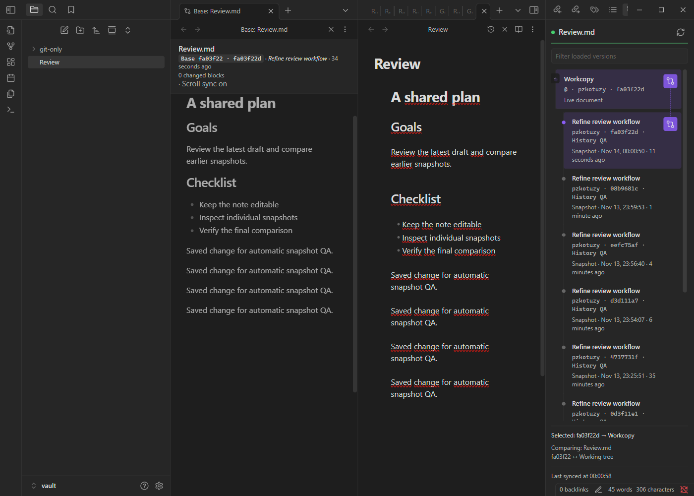
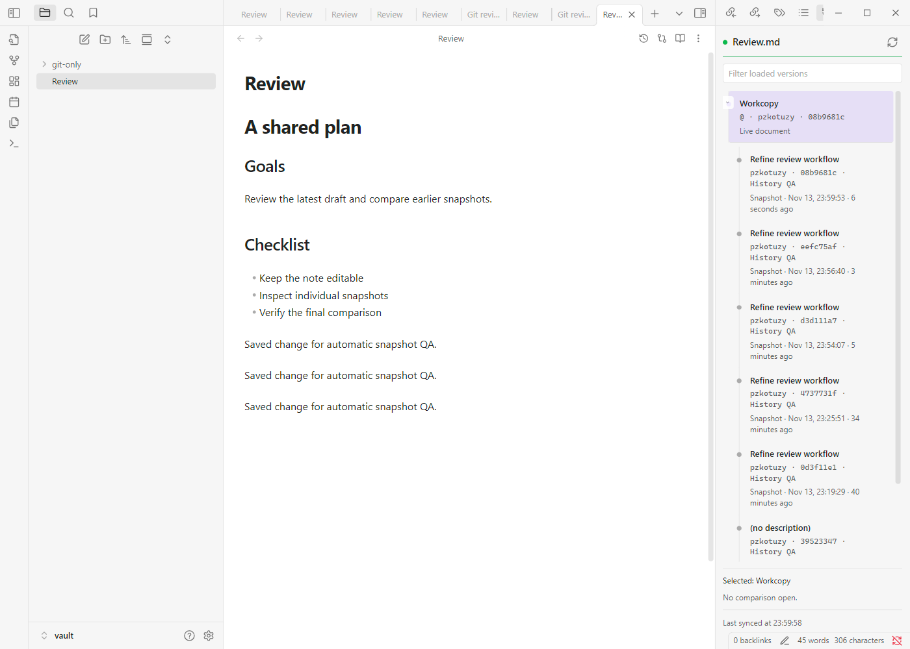
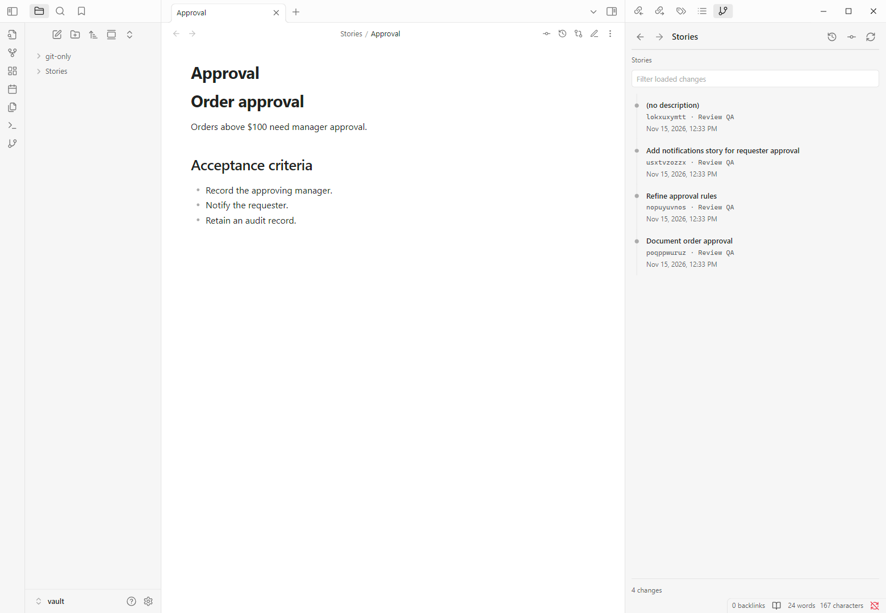
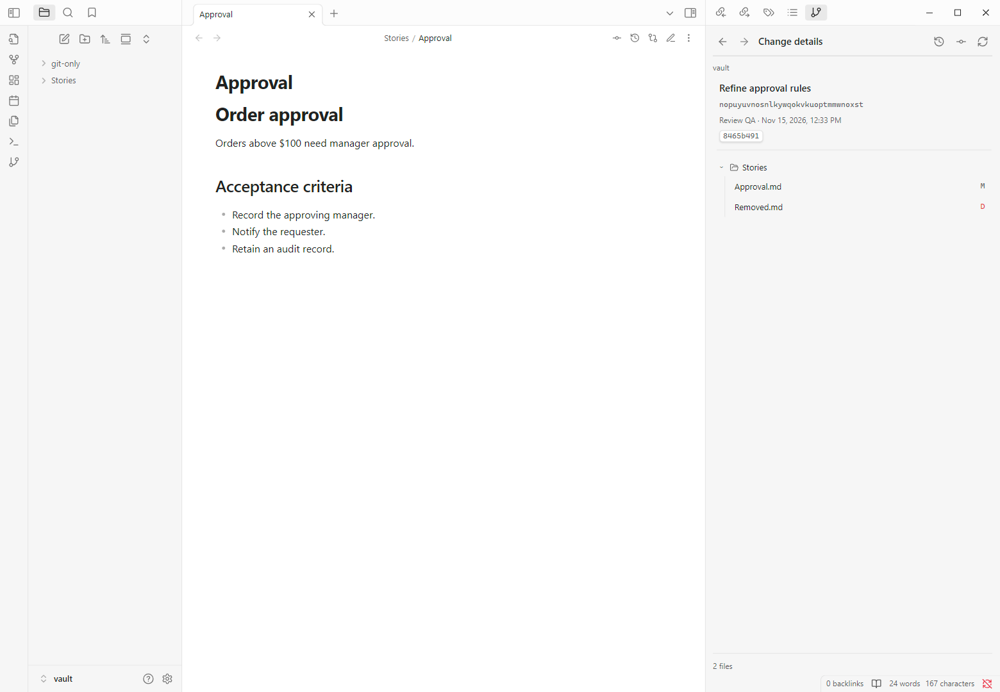
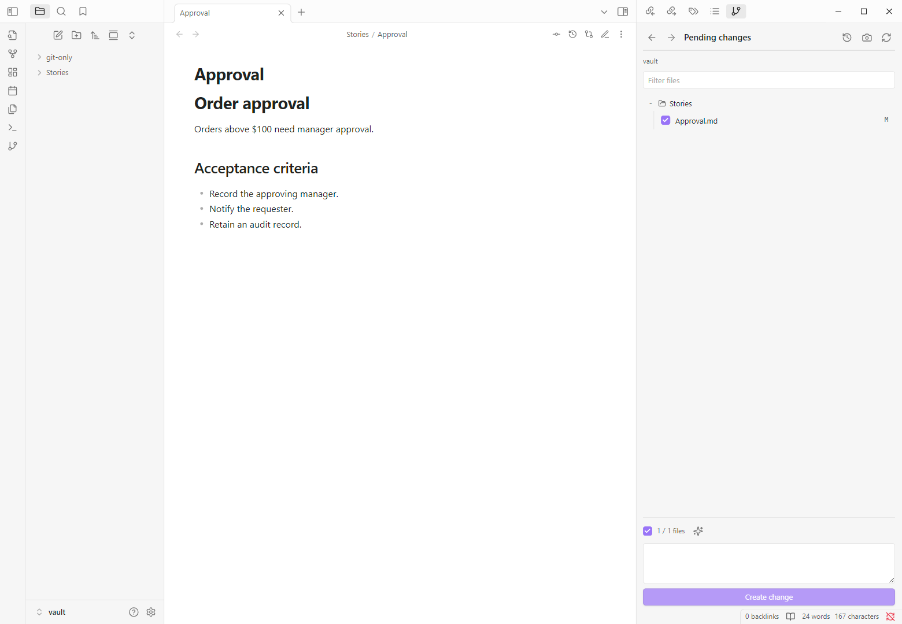
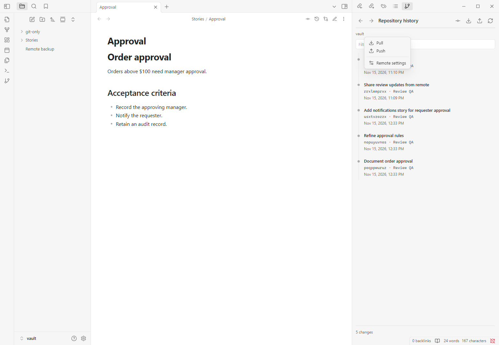
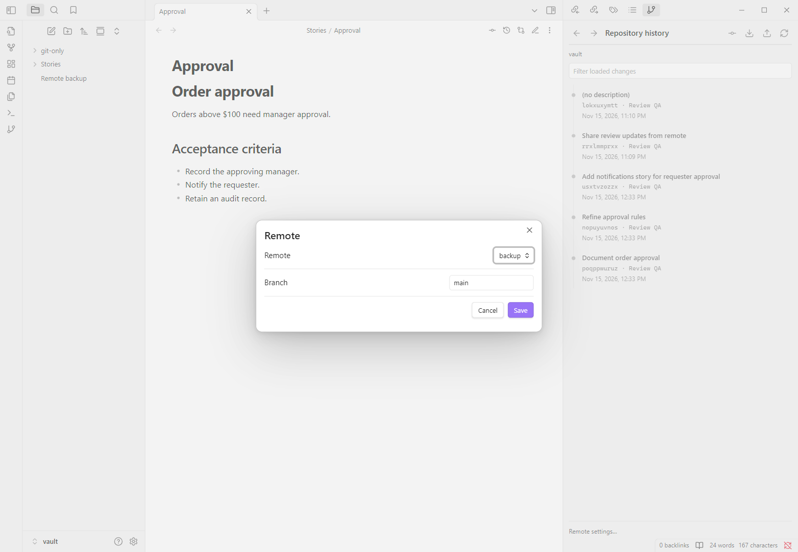
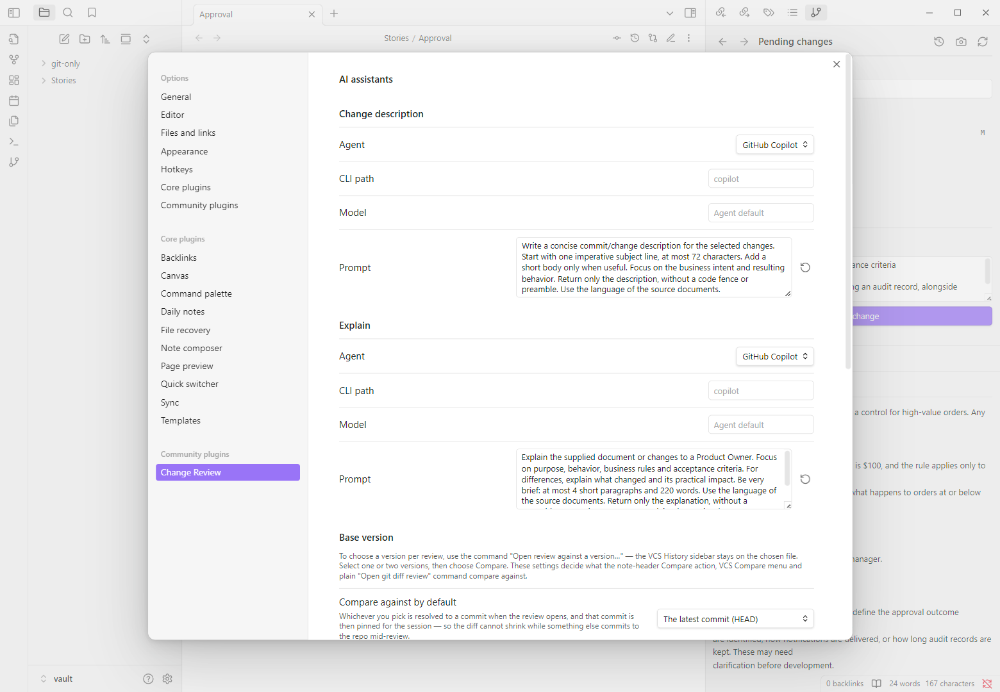
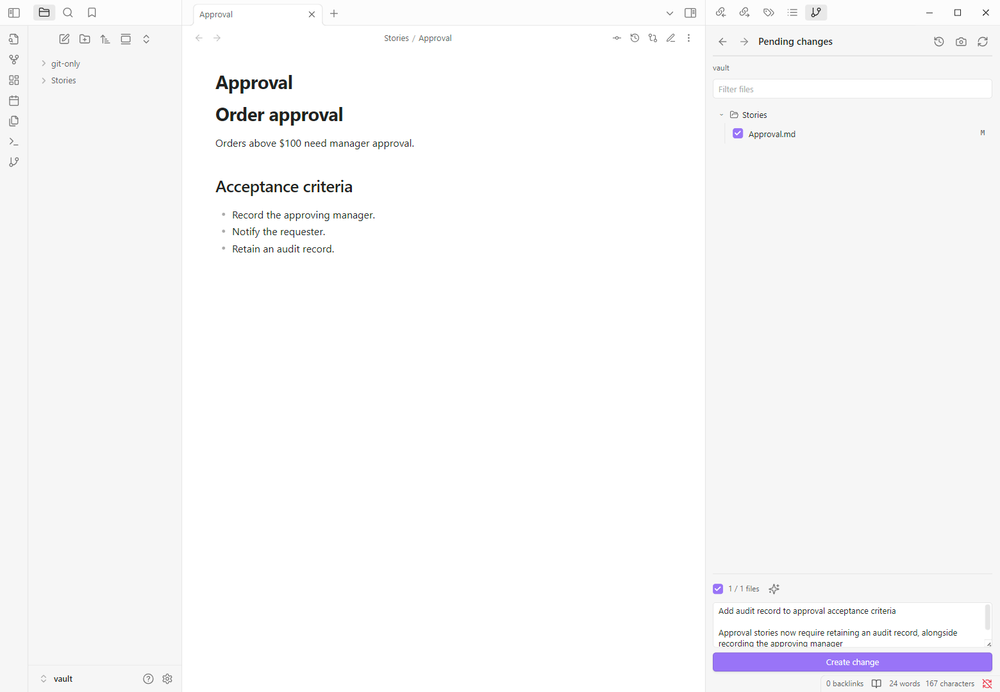
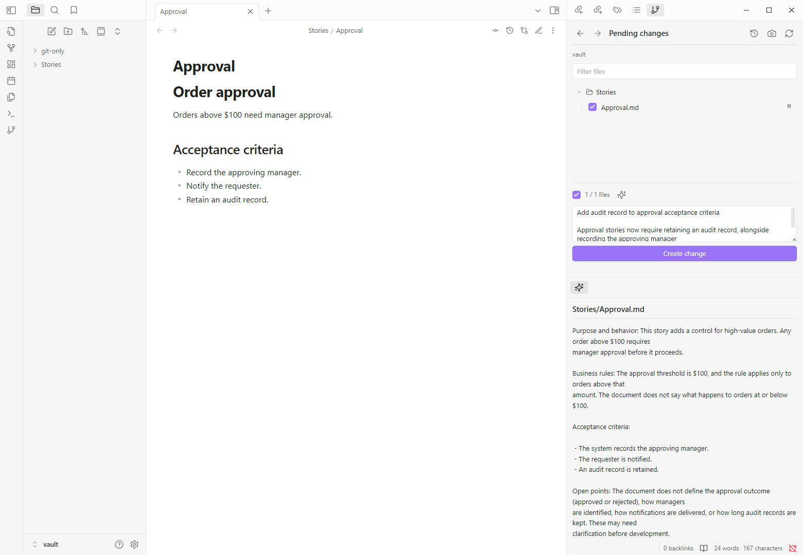

# Change Review

Review Markdown notes, explore repository history, save selected changes and push them to a remote without leaving Obsidian. Change Review supports **Jujutsu** and **Git**, with an optional AI CLI for change descriptions and short explanations.

It is designed for documentation work: draft a story, review its changes, keep snapshots while refining it, then finalize the reviewed files. The note stays editable in Obsidian's native Live Preview while historical versions appear alongside it.

Previously named **Live Git Diff**. The plugin ID and installation folder remain `live-git-diff`, so existing settings and installations continue to work.

## A typical review

1. Open **VCS History** for a note and select a version alongside **Workcopy**.
2. Compare the pair, review the highlighted changes and edit the note normally.
3. In Jujutsu, keep snapshots during the review without changing the current change ID.
4. Open **VCS Pending Changes**, select the reviewed files and enter a description—or generate one with your AI CLI.
5. Choose **Create change** to finalize the selection. Continue with the remaining files in the working copy.
6. **Push** the reviewed changes to your remote branch. Use **Pull** to bring in changes from another computer or contributor.

## Compare and edit notes

Use **Compare** in the note header to compare the current document with the configured base version. **VCS Compare** in a note's context menu opens the same review. The default **This file's previous version** compares with HEAD when this note has uncommitted changes, or HEAD's direct parent (HEAD~1) when it is clean. Settings also offer a fixed HEAD, HEAD~1, or custom reference. The note header has separate file-history (clock) and repository-history (branch) actions.

The historical version is read-only; the current note retains Obsidian's editing, selection, undo, redo and saving. Comparisons update as you type and also work in Reading view. The chosen historical revision stays pinned even if another tool changes the repository during your review. **Refresh review (re-pin the base version)** explicitly chooses a new base.

- Added content is green; removed content is red. Modified content shows both its old and new forms, with word-level highlights where useful.
- Lists are compared by item, including continuations. Tables highlight changed rows and cells, including Obsidian's native table editor.
- Visible text, formatting, links and structure count as changes. Equivalent Markdown spelling and table padding do not.
- Scroll synchronization keeps corresponding content together; toggle it from the command palette.
- Compare two historical versions without opening an editable working copy. **Swap sides** reverses their order.
- **Close comparison**, or close either participating tab, to end the review. Other note tabs stay open.



## File history and snapshots

**VCS History** in a note header or a file's context menu opens **File History**. The panel stays on that file when you switch notes, and looking up history does not open the note itself.

**Workcopy** appears first and is selected by default. Click another version, then use either selected row's compare icon or **Ctrl/Cmd+Enter** to compare the pair. Double-clicking a version also opens the comparison when two versions are selected. With Workcopy selected, choosing another historical version replaces the previous historical selection; without Workcopy, you can select two historical versions.

When the file matches HEAD, **Workcopy · HEAD** combines the live version and the latest committed version of that file in one row, retaining the commit details. Editing the file restores separate versions.

Right-click a version to compare it with Workcopy or another selected version, open its **Change details**, request an **Explain**, or clear selections. Preparing a pair does not replace an existing comparison until you apply it. Reopening the same file history retains its selection, filter and scroll position.

In a Jujutsu workspace, expand a change to see its earlier snapshots. The current Workcopy change starts expanded. The timeline filters out snapshots that did not alter this note's content; a later return to earlier content still appears as another event. Collapsing a change clears any selected snapshots beneath it.

Automatic Jujutsu snapshots run after **15 seconds** without relevant saves, when history or comparisons need a current repository state, and during normal Obsidian shutdown. Closing waits for the snapshot, even with no note or review open. Automatic save monitoring applies to notes with a history panel or comparison open; shutdown also covers Jujutsu workspaces used during this session.

Note-triggered snapshots first compare the saved file with the latest snapshot. An unchanged note does not trigger a workspace snapshot; changes to another file do not make that note dirty. Each monitored file has its own save debounce.

The camera in the left ribbon runs **Snapshot working copy (entire repository)**; the action is also available in Pending changes. Both manual and automatic snapshots record saved content across the entire Jujutsu workspace, including hidden files and files outside the vault, subject to Jujutsu tracking and ignore rules. They preserve the current change ID and do not finalize a change. The camera and shutdown snapshots apply only to Jujutsu; Git repositories do not receive automatic commits. Force termination and crashes cannot run the shutdown task.



Use the filter to search loaded versions, **Load more** for older entries, and Refresh to check for updates. The header indicator is green when history matches the displayed note, amber when it belongs to another note, and neutral when no note is displayed. **Show history for active note** switches to the displayed note when needed.

## Repository and folder history

Open **Repository history** from the ribbon, command palette or a history panel's header. It includes all visible Git refs, including a detached HEAD, or all visible Jujutsu changes. Rows show the description, author, date and identifier; click one to open its details.


For a narrower timeline, right-click a folder in Obsidian's File Explorer and choose **VCS History**. Folder history includes changes within its descendants. The same action is available for folders in a change's affected-file tree.



**Change details** shows the full description, parent changes and affected files in a collapsible folder tree. File statuses identify additions, modifications, deletions and renames. Click a file to open File History; use its context menu to open the file, view folder history, explain its changes or copy its path. Change rows also offer **Copy change ID**.



The shared **Back** and **Forward** controls connect repository, folder, change and file visits. You can move from a folder's history to a change, inspect a file, follow another change and return along the same trail. Repository and file history use separate sidebar tabs; each remains available while reviewing the other.

Deleted files can be opened from change details into historical File History. They have no Workcopy row, but their historical Markdown versions can still be compared.

## Create a change from selected files

Open **VCS Pending Changes** from a file or folder context menu, repository header, or the command palette. Opening it from a file or folder preselects that target's pending files. Select individual files with checkboxes, use Select all, or right-click a folder to select or deselect its contents. The list includes non-Markdown files as well as notes.

Use the **View** selector to switch between **File Tree** and a flat **File List**. Hover over a filename to see its full path. The plugin remembers the view and retains your filter, selected files and description when switching.

Enter a description, then choose **Create change** or press **Ctrl/Cmd+Enter**. The plugin checks that the repository still matches the list you reviewed; if files have changed, refresh and review the selection again. Failed submissions retain your description and selection.



The same action maps to each backend:

| Backend | What Create change does |
| --- | --- |
| Jujutsu | Finalizes the selected content in the current change and starts a new working change containing the remaining changes. |
| Git | Commits the saved working content of the selected paths, preserving unrelated staged files. |

Selections include whole files. Selecting a renamed file includes both its old and new paths. Editors are never forcibly saved: save the content you want to record before creating a change or taking a snapshot.

## Push and pull

Use **Push** and **Pull** in the repository panel header, or the commands **Push to remote** and **Pull from remote**. These actions apply to the repository, including when the panel shows a folder or a change. The panel shows progress, prevents repeated submissions, and refreshes history after the operation.



The plugin uses the current Git branch's configured upstream, or the uniquely tracked Jujutsu bookmark. It has no separate remote configuration: set tracking in Git/Jujutsu if it is absent or ambiguous. Existing remotes and credentials come from your VCS setup; the plugin does not store passwords or tokens.

Repository history uses green dots for commits reachable from the tracked remote branch and amber dots for commits not recorded there. This reads the local remote-tracking state; opening history does not fetch from the network. A gray **Uncommitted changes** item appears at the top when files are pending and opens the Pending changes panel.



| Action | Git | Jujutsu |
| --- | --- | --- |
| Push | Publishes the current branch's committed history to the selected remote branch. | Publishes the finalized parent of the working change and advances the selected bookmark when safe. |
| Pull | Fetches the selected branch and fast-forwards the current branch. | Fetches the selected branch and moves the pending working change onto its newer history when safe. |

Push never forces a remote update. Pull stops on divergent history or incompatible pending work instead of creating a merge or rewriting finalized changes. Resolve those cases in your VCS, then retry. Authentication failures and remote errors appear in the panel or a notice.

For remote backup, create a change and then push it. Pending notes and Jujutsu's local snapshots, evolution log and operation history are not included in a Git remote push. Pull can update files in the vault through the VCS.

## AI descriptions and Explain

AI is optional. In **Settings → AI assistants**, configure **Change description** and **Explain** independently. Each can use GitHub Copilot, OpenAI Codex or Claude Code, with its own CLI path, model and prompt. Model suggestions are editable; leave the model empty to use the agent's default. **Reset prompt** restores that feature's default instructions.

Install and authenticate the chosen CLI in a terminal first. The plugin uses its existing authentication and does not ask for or store API keys.



### Generate a description

Select files in Pending changes and use the sparkle button, **Generate description**. The agent receives evidence for those selected changes and returns an editable description. Review or adjust it before choosing Create change; generating text never creates a change automatically. The button becomes Cancel while generation is running.



### Explain a note or a change

Use **VCS Explain** from a Markdown note's context menu to understand the document. Use **Explain** on a repository change, an affected file or folder, or a file-history version to understand that selection. With two file versions selected, **Explain selected versions** describes their differences. In Pending changes, right-click the selection count for **Explain selected changes**.

The result opens in a separate reading panel. Explanations focus on purpose, behavior, business rules, acceptance criteria and the practical impact of changes. They are brief—at most five paragraphs and 250 words—and use the source documents' language by default. Right-click the result to **Copy explanation** or **Explain again**. Cancel an in-progress request from the panel header.



AI actions send the selected document or change evidence to the CLI's configured provider. Descriptions use saved working content; note explanations and Workcopy comparisons can include live editor text. Large inputs are bounded, omitted context is identified, and binary payloads are excluded. Generated outputs are not stored in the plugin's history cache; the CLI or provider may retain its own logs. Requests time out after two minutes. See [validation and compatibility notes](VALIDATION.md) for provider-specific checks and limits.

## Menus and keyboard access

| Task | Where to find it |
| --- | --- |
| Compare the current note | Note-header **Compare**; note-menu **VCS Compare**; command palette |
| File or folder history | Explorer context-menu **VCS History**; note header/menu; affected-file tree |
| Repository history | Ribbon; history-panel headers; **Open repository history** command |
| Pending changes | File/folder menus; repository header; **Open VCS Pending Changes** command |
| Change details | Click a repository row; right-click a File History version |
| Explain | Note, version, change and affected-file/folder context menus |
| Generate a description | Sparkle button beside the Pending changes selection |
| Push / Pull | Repository header, repository heading/location context menu, command palette |
| Configure remote | Repository heading/location context menu, plugin settings, command palette |
| Navigate previous/next visit | Back/Forward in the history panels |

| Key | Action in the focused panel |
| --- | --- |
| Up/Down, Home/End | Move through history rows or repository controls |
| Enter/Space | Toggle a File History selection; activate a focused native button or checkbox |
| Left/Right | Collapse/expand Jujutsu snapshot groups in File History |
| Ctrl/Cmd+Enter | Compare the selected file versions, or create the selected pending change |

Note actions are available through Obsidian's file/tab/header menus, Live Preview and Reading view. Reading menus preserve Copy for selected text. Commands can also receive custom hotkeys through Obsidian's settings. Existing review commands include closing a comparison, toggling scroll sync, refreshing annotations and copying an alignment report for troubleshooting.

## Settings and performance

Settings include the repository remote, default comparison reference, versions per page, diff colors, independent AI configurations, cache reset and debug logging. Default diff colors follow Obsidian's light or dark theme; custom colors apply to both themes.

Histories load in pages, and filters search the entries already loaded. Repository history metadata persists in the plugin's `data.json`, bounded to **200 pages, 5,000 changes and approximately 8 MiB**. It is checked against the current repository state before reuse. File-history caching remains in memory. If history changes during repository paging, the list restarts against the new state to avoid skipped or duplicated entries.

Use **Settings → Advanced → History cache → Reset cache** after unusual history maintenance or when you want to rebuild the repository cache. Ordinary commits and snapshots do not require a manual reset. Jujutsu history loads an increasing bounded prefix because its CLI does not offer an offset option.

Large Markdown comparisons run in a worker and render in batches. The first historical render can still take several seconds; subsequent edits reuse the pinned historical content.

## Installation and updates

Requirements:

- Desktop Obsidian, version **1.7.2 or later**.
- Git available on PATH, and a vault located in or containing a repository.
- For Jujutsu: **jj 0.47.1 or later** on PATH and a Git-backed workspace, either colocated or separate.
- For AI features: an installed, authenticated supported CLI. No AI service is required for comparisons or repository management.

Copy `main.js`, `manifest.json` and `styles.css` from `plugin-dist` into your vault's `.obsidian/plugins/live-git-diff/` directory. Enable **Change Review** in Community plugins. When updating, replace those three files and reload the plugin. Retain `data.json` to preserve settings and the repository cache.

Jujutsu is detected automatically before falling back to Git. A nested Git repository is handled as Git even when its parent is a Jujutsu workspace. For direct comparisons, Git's `HEAD` setting maps to Jujutsu `@-`, and `HEAD~1` maps to `@--`; a custom Jujutsu reference must resolve to one revision.

To build and check the plugin locally:

```powershell
cd plugin-src
npm ci --ignore-scripts
npm run ci
```

The build writes the installable files to `plugin-dist`. See [VALIDATION.md](VALIDATION.md) for automated checks, application verification and reproduction tools.

## Scope and limitations

Change Review covers everyday documentation review, selective recording and remote push/pull. It does not provide general branch management, rebase, reset or conflict-resolution controls. Resolve conflicts and finish Git merges outside the plugin. Standard Git hooks run when Git creates a commit.

Repository lists and selected changes support non-Markdown files, while rendered comparisons are Markdown-only. Files outside the current vault may appear in repository details but cannot be opened as vault notes. Ignored files are not force-tracked.

Historical content uses Obsidian's Markdown renderer. Historical metadata appears as read-only properties, including lists, tags, links and checkboxes. Properties and unsupported syntax are compared conservatively, plugin-generated output does not define equality, and moved blocks have no special category. When detailed analysis reaches its budget, the panel identifies simplified results. Native table highlighting reports a limitation if Obsidian's renderer prevents reliable mapping.

The plugin does not directly edit note content through vault or filesystem APIs. Your edits stay under Obsidian's control; explicit Create change actions and Jujutsu snapshots write repository history and metadata, and Pull can update working files through the VCS. AI actions generate descriptions or explanations for review and do not apply document edits.
