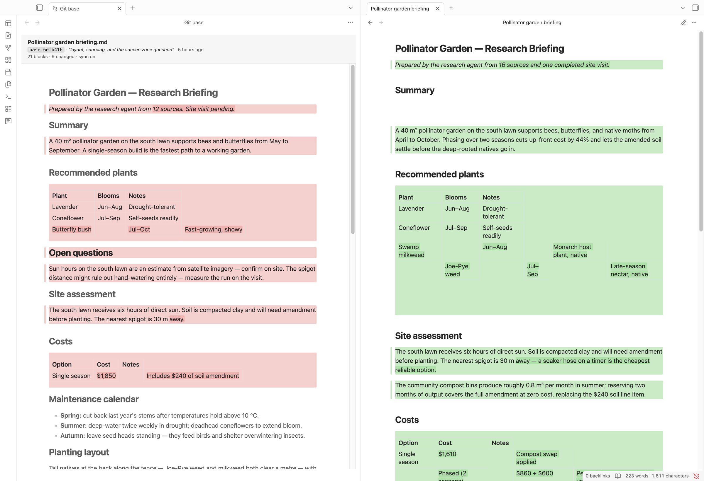
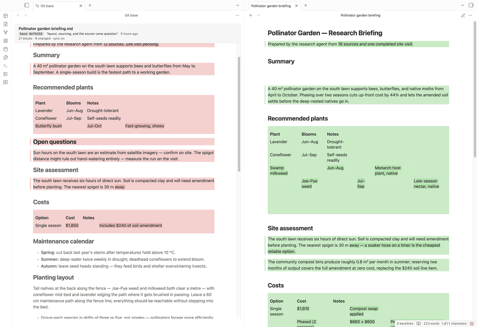
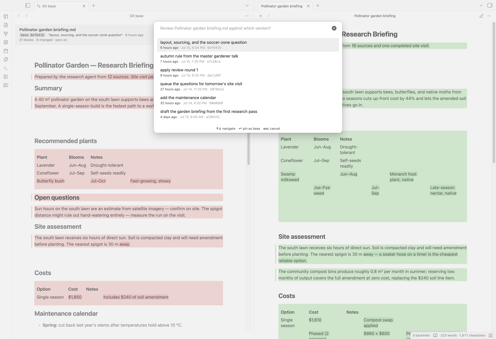
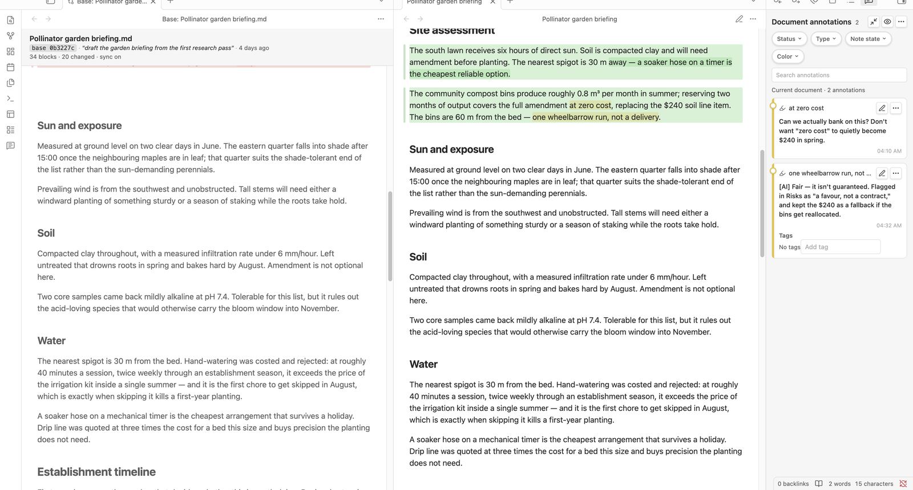

# Live Git Diff

Review a note side by side against any git version of it — both panes fully rendered, scroll-synced, inside Obsidian. The pane you review is your actual note, not a copy, so your comments and your other plugins keep working while you read the diff.



## Features

- **Side-by-side rendered diff.** The git version on one side, your real note on the other, both typeset by Obsidian in your theme.
- **Compare against any version.** Pick a commit by subject and age from a searchable list. Follows renames.
- **Word-level highlights** inside changed blocks, on both sides.
- **Scroll sync.** Scroll either pane and the other follows, with blank space reserved where one side has text the other doesn't.
- **Your annotations survive.** The plugin only adds CSS classes to blocks Obsidian already rendered — it never rebuilds the view. Comment plugins, text-to-speech, and links stay anchored through the whole review.
- **Read-only, and checked.** Nothing is written to disk. The old version is read straight into memory, and a build gate fails the build if a write call ever reaches the bundle.



## Why another diff plugin?

The diff plugins I could find show raw markdown — `**bold**`, pipe tables and all. That's the right tool for merging vaults or applying patches, but it isn't the document you wrote. And a rendered diff usually means building a separate preview just for the review, which orphans anything that was anchored to the original view. This plugin decorates the note you already have open instead. If there's a plugin that already does this, open an issue — I'd genuinely like to see it.

## Requirements

- Desktop Obsidian 1.4.0+ (the plugin runs `git`, which mobile can't).
- `git` on your PATH.
- The note lives in a git repository. The vault root doesn't have to be the git root — a vault nested inside a bigger repo is fine.

## Install

### With BRAT

[BRAT](https://github.com/TfTHacker/obsidian42-brat) installs from the latest GitHub release, so this route works once the first release is up.

1. Install **Obsidian42 - BRAT** from Community plugins and enable it.
2. Command palette → **BRAT: Add a beta plugin for testing**.
3. Paste `https://github.com/jkosturko/obsidian-live-git-diff`.
4. Enable **Live Git Diff** in **Settings → Community plugins**.

### Manually

Download `main.js`, `manifest.json`, and `styles.css` from the [latest release](https://github.com/jkosturko/obsidian-live-git-diff/releases) into `<your-vault>/.obsidian/plugins/live-git-diff/`, restart Obsidian, and enable the plugin. Or build from source:

```bash
git clone https://github.com/jkosturko/obsidian-live-git-diff
cd obsidian-live-git-diff/plugin-src
npm ci && npm run build
cp ../plugin-dist/{main.js,manifest.json,styles.css} "<your-vault>/.obsidian/plugins/live-git-diff/"
```

Not in the community directory yet — BRAT or manual for now.

## How to use

Open a note that lives in a git repo, switch to **Reading view**, and run **Open review against a version…** from the command palette. Pick a commit; a second pane opens beside your note with that version, and the changes light up in both.



The picked version stays pinned while the review is open, so the diff can't shrink under you while something else commits to the repo. Sessions live in memory — close the review and it's gone.

| Command | What it does |
| --- | --- |
| **Open review against a version…** | Pick this file's base version from a searchable list. |
| **Open git diff review for this file** | Skips the picker and uses your default base (HEAD unless you change it). |
| **Close review** | Removes every decoration and closes the base pane. |
| **Refresh review (re-pin the base version)** | Re-resolves the base and re-diffs. |
| **Toggle scroll sync** | The base pane's header shows whether it's on. |
| **Copy alignment report to clipboard** | A JSON diagnostic for bug reports. |

**If the diff comes up empty:** your changes are probably already committed, and you're comparing against HEAD — which contains them. Pick the commit from before the work started instead. You can also change the default base in settings.

### Reviewing an agent's edits

The workflow this was built for: an AI agent edits your notes and commits as it goes, and you review its work without giving up your annotations.

1. Open a review against the last version you recognise.
2. Comment on the note with your annotation plugin ([side-comments](https://github.com/guoxueziliao/side-comments) keeps comments in a sidecar file, so the `.md` stays clean).
3. The agent reads the comments, revises, and commits.
4. Run **Open git diff review for this file** again — the base stays pinned, so you see the total change since your baseline, and your comments are exactly where you left them.



You don't have to run git yourself for any of this. One line in your agent's instruction file is enough:

> After each meaningful change to my notes, commit with a one-line message saying what you did and why.

The version picker then fills with checkpoints you can actually recognise.

## Settings

| Setting | Default | Notes |
| --- | --- | --- |
| Compare against by default | HEAD | What the quick command pins: HEAD (shows uncommitted changes), HEAD~1, this file's previous version, or a specific ref. |
| Ref | `main` | For "a specific ref" — anything git can resolve. |
| Versions to list | 50 | How many commits the picker shows. |
| Colors | GitHub's diff palette | Four fields: inserted/deleted wash, added/removed rail. Any CSS color, alpha included. The defaults follow your light/dark theme; an override applies to both. |
| Debug logging | Off | Verbose console output. |

## Limitations

- The diff pairs **blocks** (paragraphs, lists, tables), not lines. A block rewritten past recognition shows as a removal plus an addition rather than one modification.
- Highlights appear in **Reading view** only — Obsidian's post-processors don't run in Live Preview.
- The base pane opens to the left of your note. Drag its tab across if you'd rather have it on the right; the workspace remembers.
- Links and embeds don't resolve in the base pane. That's deliberate — it's what keeps other plugins from anchoring your current annotations onto the old text.
- A little vertical drift is normal next to inserted or deleted regions. It's bounded, and it doesn't grow as you scroll.
- Desktop only, and the note must be tracked in git at the version you compare against.

## Privacy

This plugin never writes to your notes and never talks to the network. It runs `git` to read old versions, renders them in memory, and adds CSS classes to your rendered note — that's the whole footprint. The read-only claim is checked mechanically on every build: [a gate](plugin-src/tools/check-invariant.mjs) scans the shipped bundle for write calls, filesystem imports, and `innerHTML`, and CI runs it on every push. The only thing it stores is its own settings, which Obsidian removes when you uninstall.

## Thanks

- **VS Code** — the markdown preview's diff styling and Monaco's diff editor are the prior art here: the rail technique, the two-color scheme, and the view-zone idea that keeps two panes aligned.
- **[GitHub's VS Code themes](https://github.com/primer/github-vscode-theme)** for the diff palette in both light and dark.
- **Obsidian's reading view**, which the base pane inherits its typography from.

How it all works — and why the obvious approaches don't — is written up in [docs/ARCHITECTURE.md](docs/ARCHITECTURE.md).

## Support

If this plugin is useful to you, a star helps other people find it. And if you'd like to support development: [Buy Me a Coffee](https://buymeacoffee.com/jkosturko).

## License

[MIT](LICENSE) © 2026 Jessica Kosturko
